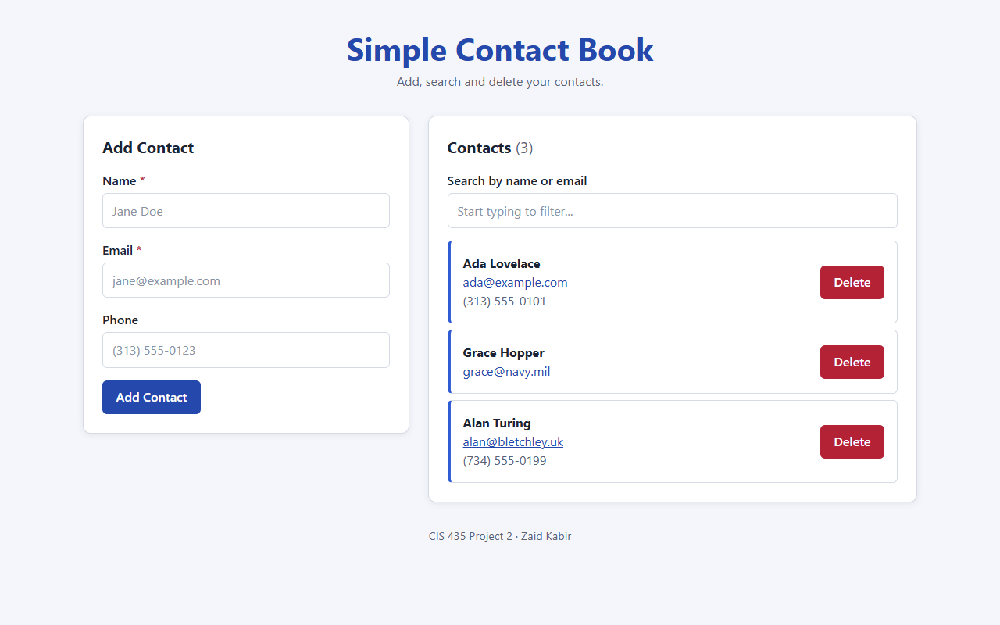
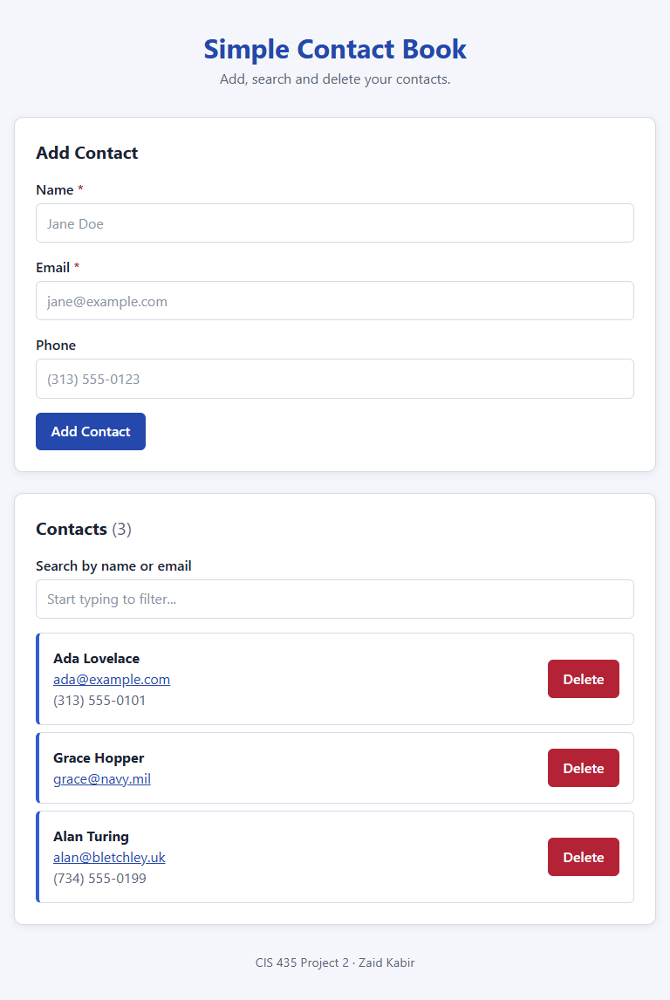
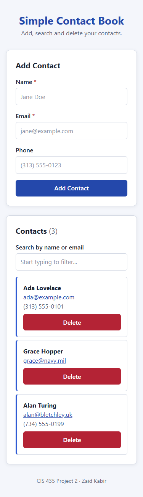

# Simple Contact Book

**CIS 435 – Project 2** · Zaid Kabir

A single-page React app (built with Vite) for adding, listing, searching and deleting contacts. Data lives in memory for the current session.

**Live site:** https://kabirz-umdears.github.io/CIS-435-Fall2026-Project2/

## Features

- **Add contact** – controlled form (Name, Email, Phone). Name and Email are required, and the email is checked with a simple regex. Errors show inline under each field; the form clears after a successful add.
- **List contacts** – rendered with `map`, using each contact's `id` as the `key`.
- **Delete contact** – each contact has a Delete button that removes it by `id` with `filter`.
- **Search/filter** – case-insensitive filter by name or email as you type.
- **Empty states** – "No contacts yet. Add one above!" when the list is empty, and "No matches found for '…'" when the search hides everything.
- **Responsive** – one column on mobile, stacked cards on tablet, two columns on desktop. Inputs, buttons and links have visible focus outlines.

## Components

| Component | Role |
| --- | --- |
| `App` | Owns the `contacts` array and `filterText` state; passes data and handlers down as props |
| `ContactForm` | Controlled inputs and validation; calls `onAdd` on submit |
| `SearchBar` | Controlled search input; calls `onChange` |
| `ContactList` | Shows the filtered contacts or the right empty/no-match message |
| `ContactItem` | One contact card with a Delete button |

State is never mutated directly: new arrays are created with the spread operator and `filter`.

## Screenshots

### Desktop (1280px)


### Tablet (768px)


### Mobile (375px)


## Run locally

```bash
npm install
npm run dev
```
